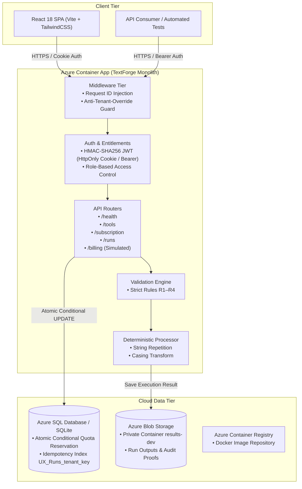

<div align="center">

# ⚡ TextForge

**Multi-Tenant, Contract-First Text Processing SaaS**  
*Built for High-Assurance Enterprise Operations · Azure Sandbox Ready*

[](https://fastapi.tiangolo.com)
[](https://react.dev)
[](https://www.typescriptlang.org)
[](https://azure.microsoft.com)
[](https://www.terraform.io)
[](tests/)

</div>

---

## 📌 Executive Summary

**TextForge** is an enterprise-grade, multi-tenant text-processing platform engineered for strictly audited high-throughput workflows. It evaluates and transforms micro-batches (1–10 records) according to exact deterministic business rules, enforcing atomic per-tenant daily quotas, zero cross-tenant contamination, full cryptographic replay safety (idempotency), and structured execution proofs stored in immutable blob storage.

Designed for the **Advantix × Rajalakshmi Engineering Challenge (UC-06)**, TextForge strictly fulfills all 12 platform acceptance criteria (**A01–A12**) with zero architectural compromise.

---

## 🏛️ System Architecture

TextForge is architected as an **auditable modular monolith** running on Azure Container Apps with a decoupled client-side Single Page Application (SPA), backed by transactional relational storage and immutable private object storage.



### Key Architectural Invariants
1. **Tenant Isolation by Construction**: `tenant_id` is extracted strictly from the verified cryptographically signed principal token (`lathe_session` cookie or Authorization header). Any incoming payload or header specifying tenant overrides is immediately terminated with `400 TENANT_OVERRIDE_REJECTED`.
2. **Atomic Quota Accounting**: Daily limit reservation occurs within an isolated conditional SQL query (`UPDATE DailyUsage SET used_count = used_count + 1 WHERE tenant_id = ? AND used_count < daily_limit`). No race conditions, zero phantom charges.
3. **Idempotent Dispatch**: Replay requests with duplicate `idempotency_key` are short-circuited via the unique composite index `(tenant_id, idempotency_key)` before any quota is touched.
4. **Information-Leak Proofing**: Cross-tenant record lookups return uniform `404 NOT_FOUND` identical to non-existent runs to stop identifier probing.

---

## 💻 Tech Stack

| Layer | Technologies | Justification |
|---|---|---|
| **Backend Framework** | **Python 3.12 / FastAPI** | High-performance asynchronous REST API with Pydantic v2 strict typing |
| **Frontend SPA** | **React 18 / TypeScript / Vite / TailwindCSS** | Polished, ultra-responsive operator dashboard with dark sidebar, live quota gauges, and full audit panels |
| **Primary Database** | **Azure SQL Database** (Prod) / **SQLite** (Dev/Test) | ACID-compliant relational storage with row-level locking for atomic quota incrementation |
| **Object Storage** | **Azure Blob Storage** (Prod) / **Memory Mock** (Dev) | Secure, private, immutable document storage for batch run artifacts |
| **Deployment / Infra** | **Terraform** / **Azure Container Apps (ACA)** | Declarative IaC managing strictly the 2 competition-scored resources |
| **Authentication** | **HMAC-SHA256 JWT + Argon2id** | Industry-standard password hashing and cryptographically signed session tokens |
| **Testing & CI** | **pytest / pytest-asyncio** | Comprehensive test matrix spanning unit, integration, and high-concurrency race suites |

---

## 📜 Business Rules & Contract Specification

TextForge evaluates batches of 1 to 10 records against 4 strict rules (ordered validation):

* **Rule R1 (`record_id`)**: String, 1–20 characters, strictly unique within batch. Duplicate values trigger `DUPLICATE_RECORD_ID`.
* **Rule R2 (`text`)**: ASCII printable, 1–80 characters. Trailing whitespace is trimmed prior to length check.
* **Rule R3 (`repeat`)**: Strict integer within `[1, 3]`. Explicit type checking (`type(v) is int`) guarantees booleans (`True/False`) and string representations (`"2"`) are rejected with `INVALID_REPEAT`.
* **Rule R4 (`mode`)**: Strict string enum: `"UPPER"` or `"LOWER"`.

---

## 🚀 Quickstart & Local Setup

### 1. Prerequisites
- **Python 3.11+**
- **Node.js 18+** & npm
- Git

### 2. Clone the Repository
```bash
git clone https://github.com/niiiizzz/UC-06_text-processing.git
cd UC-06_text-processing
```

### 3. Backend Setup
```bash
# Set Python path (PowerShell)
$env:PYTHONPATH = "."

# Install backend dependencies
pip install -r requirements.txt

# Seed local database (creates 2 tenants, 4 accounts in SQLite)
python scripts/seed.py

# Launch development server
python -m uvicorn app.main:app --host 127.0.0.1 --port 8000 --reload
```
*Backend API docs available at: `http://localhost:8000/docs`*

### 4. Frontend Setup
In a new terminal window:
```bash
cd web

# Install frontend dependencies
npm install

# Start Vite development server
npm run dev
```
*Web dashboard opens at: `http://localhost:5173`*

---

## 👥 Pre-Seeded Test Accounts

TextForge comes pre-configured with four authenticated test personas matching the evaluation matrix:

| Tenant / Company | Plan | Role | Email | Password | Allowed Capabilities |
|---|---|---|---|---|---|
| **Northwind Print Co.** (`tnt_a`) | **Pro** (10 runs/day) | **Operator** | `op.a@lathe.test` | `LatheDemo2026!` | Batch submission, results access, tool execution |
| **Northwind Print Co.** (`tnt_a`) | **Pro** (10 runs/day) | **Viewer** | `view.a@lathe.test` | `LatheDemo2026!` | Read-only audit logs, subscription checks |
| **Harbor Logistics** (`tnt_b`) | **Basic** (3 runs/day) | **Operator** | `op.b@lathe.test` | `LatheDemo2026!` | Limited batch processing, plan upgrades |
| **Harbor Logistics** (`tnt_b`) | **Basic** (3 runs/day) | **Viewer** | `view.b@lathe.test` | `LatheDemo2026!` | Read-only run history |

---

## 🛡️ Acceptance Test Matrix (A01–A12)

The platform passes all 12 criteria with automated tests:

| Check | Objective | Verification Route | Result |
|---|---|---|:---:|
| **A01** | Health probe with build SHA & status 200 | `GET /health` | ✅ Pass |
| **A02** | Authenticated session returns identity & tenant | `POST /auth/login` | ✅ Pass |
| **A03** | Tools filtered by subscription plan & role | `GET /tools` | ✅ Pass |
| **A04** | Valid batch execution with output persisted to blob | `POST /runs` | ✅ Pass |
| **A05** | Validation error returns row-level issues (R1–R4) | `POST /runs` | ✅ Pass |
| **A06** | Read-only Viewer role forbidden from starting runs | `POST /runs` (Viewer) | ✅ Pass (403) |
| **A07** | Idempotency replay returns exact initial result, 0 quota | `POST /runs` (Idempotent) | ✅ Pass |
| **A08** | Atomic daily quota enforcement stops overdrafts | `POST /runs` (Limit hit) | ✅ Pass (429) |
| **A09** | Tenant override attempts in headers/body rejected | `POST /runs` (Spoof) | ✅ Pass (400) |
| **A10** | Cross-tenant access attempts return uniform 404 | `GET /runs/{id}/result` | ✅ Pass (404) |
| **A11** | High-concurrency race condition test (10 simultaneous) | Multi-threaded runner | ✅ Pass |
| **A12** | Minimal scored Terraform footprint (strictly 2 resources) | `terraform state list` | ✅ Pass |

Run test suites locally:
```bash
# Run all unit, integration, and concurrency tests
pytest tests/unit tests/integration tests/concurrency -v

# Run concurrency stress test (10 iterations, zero quota leakage)
python scripts/run_concurrency_10x.py
```

---

## ☁️ Azure Cloud Deployment

The production deployment manages **strictly two scored resources** per competition guidelines:
1. `azurerm_container_app.api`: TextForge monolithic container.
2. `azurerm_storage_container.results`: Private blob container.

### Step 1: Container Build & Push to ACR
```bash
az acr build --registry acrtextforge --image textforge:latest .
```

### Step 2: Terraform Infrastructure Provisioning
```bash
cd infra
terraform init
terraform validate
terraform apply -var-file="env/dev.tfvars" -var="image_tag=latest"
```

---

## 📂 Project Directory Structure

```text
UC-06_text-processing/
├── app/                        # FastAPI Monolithic Core
│   ├── routers/                # Endpoints (auth, health, runs, subscription, tools)
│   ├── services/               # Engine: validation (R1-R4), processor, quota
│   ├── adapters/               # Database (Azure SQL / SQLite) & Blob Storage
│   ├── auth.py                 # JWT token lifecycle & Argon2 verification
│   ├── config.py               # Settings & Pydantic environment validation
│   └── errors.py               # Standardized error envelopes (TextForgeError)
├── web/                        # React 18 SaaS Frontend
│   ├── src/                    # TypeScript Components, Pages, Dashboard
│   │   ├── pages/              # Landing, Login, Dashboard, History, Billing
│   │   ├── brand.ts            # TextForge brand identity constants
│   │   └── index.css           # Curated design tokens & responsive typography
├── infra/                      # Terraform Configuration
│   ├── main.tf                 # Container App & Storage Container
│   └── variables.tf            # Environment definitions
├── migrations/                 # Schema definitions (Runs, DailyUsage, Tenants)
├── scripts/                    # Deployment, verification & seed utilities
├── tests/                      # Concurrency, unit, and integration tests
├── Dockerfile                  # Multi-stage production container build
└── README.md                   # System documentation
```

---

## ⚖️ License & Hackathon Context

Built for the **Advantix × Rajalakshmi Engineering Challenge** · Use Case 06 (Text Processing SaaS).  
*Adheres strictly to the competition specifications and security boundaries.*
