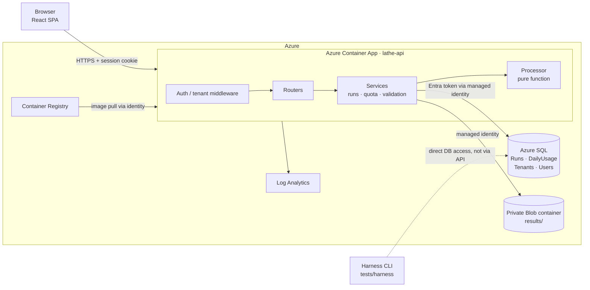
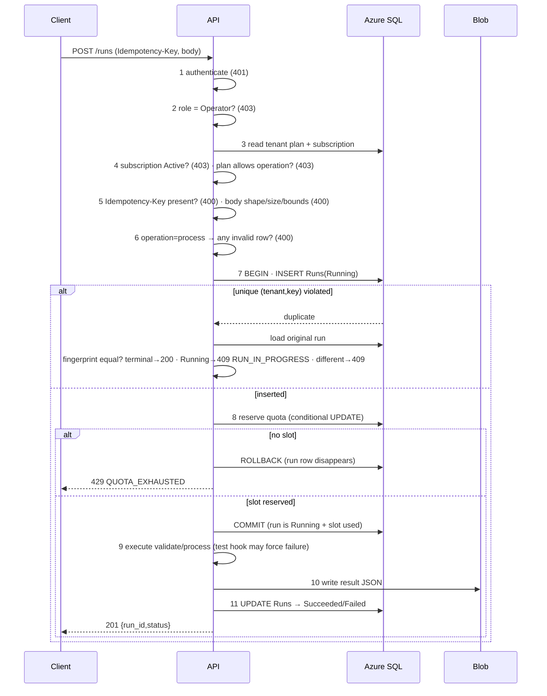

# 03 · ARCHITECTURE — Lathe

## 1. Architecture at a glance

One container, one database, one private blob container. Deliberately boring.



### Design decisions (ADR summary)

| ADR | Decision | Why |
|---|---|---|
| ADR-01 | Monolith in one container serving API + built SPA | Matches "one Container App"; fewer moving parts in a 5-hour build. |
| ADR-02 | Python 3.12 + FastAPI | Pure-function processor, strong validation control, fast to write and test. |
| ADR-03 | React + Vite + TS + Tailwind, built into `/app/static` | Frontend skill fit; no extra hosting resource. |
| ADR-04 | Azure SQL with T-SQL transactions for quota + idempotency | Atomicity must be provable; the DB is the only shared state. |
| ADR-05 | Results as JSON blobs, metadata in `Runs` | Uses the mandated private Blob container; survives restarts (A04). |
| ADR-06 | Managed identity for SQL and Blob in cloud; connection string/Azurite locally | No secrets in code or image. |
| ADR-07 | Session = signed JWT in an HttpOnly cookie; Bearer accepted for API tests | Verified-session requirement; testable via curl. |
| ADR-08 | Terraform manages only the two scored resources; prerequisites in `infra/bootstrap/` referenced through data sources | Matches "two Terraform resources" and "assigned resources only" (A01). |
| ADR-09 | Harness is a CLI that talks to SQL directly | "Reset is not exposed through the product API." |
| ADR-10 | Billing/signup simulations are feature-flagged modules | Keeps scored surface identical to the contract. |

## 2. Repository layout

```
lathe/
├── README.md
├── AGENTS.md                  # copy of docs/06_AGENTS.md (repo root for Antigravity)
├── SKILLS.md                  # engineering playbook for agents
├── docs/                      # the ten planning docs + DECISIONS.md
├── app/                       # backend
│   ├── main.py                # FastAPI app factory, static mount
│   ├── config.py              # env parsing, feature flags
│   ├── deps.py                # auth/tenant dependencies
│   ├── errors.py              # error envelope + exception handlers
│   ├── routers/
│   │   ├── health.py  tools.py  subscription.py  runs.py  auth.py
│   │   └── billing.py         # flagged: Tier 2
│   ├── services/
│   │   ├── runs.py            # accept / replay / execute / persist
│   │   ├── quota.py           # atomic reservation
│   │   ├── validation.py      # R1–R4
│   │   ├── processor.py       # pure text processor
│   │   ├── fingerprint.py
│   │   └── entitlements.py    # role/plan/subscription checks
│   ├── adapters/
│   │   ├── sql.py  blob.py  auth_provider.py
│   └── models.py              # pydantic schemas
├── web/                       # frontend (Vite)
│   └── src/{pages,components,lib,styles}
├── migrations/
│   ├── 001_runs.sql
│   ├── 002_daily_usage.sql
│   ├── 003_platform_seed.sql
│   └── 004_billing_sim.sql    # flagged
├── infra/
│   ├── main.tf  variables.tf  outputs.tf  versions.tf
│   ├── env/dev.tfvars  env/test.tfvars
│   └── bootstrap/             # one-time prerequisites if organisers don't supply
├── scripts/
│   ├── deploy.sh  verify.sh  cleanup.sh
├── skills/text-tools/SKILL.md
├── tests/
│   ├── unit/  integration/  concurrency/  e2e/  harness/
├── evidence/                  # redacted outputs per check A01–A12
├── Dockerfile
└── docker-compose.yml         # local SQL + Azurite
```

## 3. Request pipeline

Every request passes through, in order:

1. **Request ID** middleware (`X-Request-Id` generated if absent; echoed back).
2. **Tenant-override guard**: reject if query/body/headers contain `tenant`, `tenant_id`, `tenantId`, `X-Tenant-*` (400 `TENANT_OVERRIDE_REJECTED`).
3. **Auth dependency**: parse cookie or Bearer → verified claims → `Principal{user_id, tenant_id, role}`; 401 if absent or invalid. `/health` and `/auth/login` bypass.
4. **Route handler** → service layer → adapters.
5. **Error envelope** handler: `{"error": {"code","message","details"?}}`, never leaking stack traces.
6. **Access log** with `request_id`, `tenant_id`, route, status, latency. No text payloads.

## 4. `POST /runs` — decision order

The order is part of the contract. Implement exactly as below.



Notes:
- **Replay precedes quota** because the `Runs` insert fails on the unique index before the quota step is reached (FR-12).
- **Rejected requests count zero** because steps 1–6 happen before any write and step 8 failure rolls back the transaction.
- **Two simultaneous identical keys:** the second insert blocks on the unique index until the first commits, then takes the replay path (`RUN_IN_PROGRESS` if still Running, else the terminal run).
- **Two concurrent new requests, one slot left:** both insert their own `Runs` rows, then serialise on the `DailyUsage` row lock; only one conditional update succeeds.
- **Failure after acceptance** (processor exception, blob failure, or forced hook) → `Failed`, error stored, slot stays used.

## 5. Module responsibilities

| Module | Responsibility | Must not |
|---|---|---|
| `routers/*` | HTTP mapping, status codes, response shaping | Contain business logic |
| `services/runs.py` | Orchestrate acceptance → execution → persistence | Talk to HTTP types |
| `services/quota.py` | Atomic reserve via SQL | Cache counters in memory |
| `services/validation.py` | R1–R4, issue list, valid/invalid counts | Touch DB/IO |
| `services/processor.py` | Pure `process(rows) -> {summary, rows, issues}` | Touch DB/IO, random, time |
| `adapters/sql.py` | Connections, retries on deadlock (1205), parameterised queries | Build SQL by string concat with user data |
| `adapters/blob.py` | Put/get JSON at `results/{tenant}/{run_id}.json` | Make blobs public |
| `deps.py` | Resolve `Principal` | Read tenant from request data |

## 6. Azure topology

| Resource | Owner | Notes |
|---|---|---|
| Resource group, Log Analytics, Container Apps environment, ACR, Azure SQL (server + DB), storage account, user-assigned managed identity | Organisers (or `infra/bootstrap/`) | Referenced with Terraform **data sources** |
| **Container App `lathe-<env>`** | **Terraform (scored resource 1)** | Image from ACR, UAMI attached, env vars, secret refs, ingress external 443, probe `/health` |
| **Blob container `results-<env>` (private)** | **Terraform (scored resource 2)** | `container_access_type = "private"` |

RBAC (assigned by organisers/bootstrap, not scored Terraform):
- UAMI → `AcrPull` on ACR
- UAMI → `Storage Blob Data Contributor` on the storage account (container scope if possible)
- UAMI → SQL contained user with `db_datareader`, `db_datawriter`, `EXECUTE` (created via `CREATE USER [<uami-name>] FROM EXTERNAL PROVIDER`)

## 7. Configuration

| Variable | Example | Notes |
|---|---|---|
| `APP_ENV` | `dev` | `dev` / `test` |
| `SQL_SERVER`, `SQL_DATABASE` | `lathe-sql.database.windows.net` | |
| `SQL_AUTH_MODE` | `msi` or `sql` | `msi` in cloud |
| `AZURE_CLIENT_ID` | UAMI client id | Needed for user-assigned identity |
| `BLOB_ACCOUNT_URL` | `https://<acct>.blob.core.windows.net` | |
| `BLOB_CONTAINER` | `results-dev` | |
| `SESSION_SECRET` | (secret ref) | 32+ random bytes |
| `SESSION_TTL_MINUTES` | `480` | |
| `ENABLE_TEST_HOOKS` | `false` | `true` only in dev sandbox for A11 |
| `FEATURE_BILLING_SIM` | `false` | Tier 2 |
| `FEATURE_SIGNUP_SIM` | `false` | Tier 2 |

## 8. Observability

- JSON logs → Log Analytics. Fields: `ts, level, request_id, tenant_id, user_id, route, status, latency_ms, run_id, event`.
- Events: `run.accepted`, `run.replayed`, `run.rejected.<reason>`, `run.succeeded`, `run.failed`, `quota.exhausted`, `auth.denied`.
- **Never log** `text` values, cookies, tokens, passwords, or connection strings.
- `/health` returns `{"status":"ok","version":"<git sha>"}` only.

## 9. Failure modes

| Failure | Behaviour |
|---|---|
| SQL unreachable at request time | 503 `DEPENDENCY_UNAVAILABLE`; no run created |
| Blob write fails after quota reserved | Run → `Failed` (`RESULT_STORE_ERROR`), slot stays used |
| Process crash mid-run | Out of scope (no recovery); run remains `Running` — documented limitation |
| Deadlock (1205) | Retry the transaction up to 3 times with jitter |
| Clock skew | UTC day computed by SQL (`SYSUTCDATETIME()`), not the app host |

## 10. Build and deploy pipeline

`docker build` (multi-stage: node build → python runtime) → `az acr build` or `docker push` → `scripts/deploy.sh` (terraform apply with `image_tag`) → `scripts/verify.sh` (health, fixtures, second plan no-op). Rollback = `deploy.sh --image-tag <previous>`.
