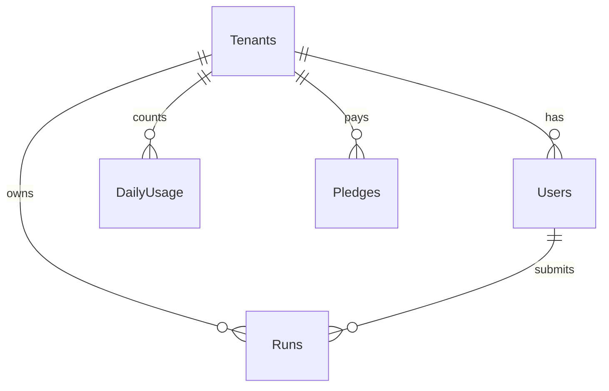

# 04 · DATABASE — Lathe

Engine: **Azure SQL Database** (T-SQL). Local dev: SQL Server container.
Scored tables: **`Runs`** and **`DailyUsage`** (exactly two, per the case document).
Platform seed tables (not scored, normally organiser-supplied): **`Tenants`**, **`Users`**.
Optional Tier 2 table (flagged): **`Pledges`**.

Migrations are forward-only, numbered, idempotent (`IF OBJECT_ID(...) IS NULL`), and applied by `scripts/migrate.py` (called from `deploy.sh`/`verify.sh`, and from the app on dev start).

---

## 1. Entity overview



## 2. Migration `001_runs.sql` (scored)

```sql
IF OBJECT_ID('dbo.Runs', 'U') IS NULL
BEGIN
  CREATE TABLE dbo.Runs (
    run_id            UNIQUEIDENTIFIER NOT NULL CONSTRAINT PK_Runs PRIMARY KEY DEFAULT NEWID(),
    tenant_id         NVARCHAR(40)     NOT NULL,
    idempotency_key   NVARCHAR(128)    NOT NULL,
    input_fingerprint CHAR(64)         NOT NULL,           -- sha256 hex of canonical {operation, records}
    operation         VARCHAR(10)      NOT NULL,
    status            VARCHAR(10)      NOT NULL,
    submitted_by      NVARCHAR(40)     NOT NULL,
    row_count         TINYINT          NOT NULL,
    valid_rows        TINYINT          NULL,
    invalid_rows      TINYINT          NULL,
    result_blob_path  NVARCHAR(300)    NULL,
    error_code        NVARCHAR(60)     NULL,
    error_message     NVARCHAR(400)    NULL,
    created_at        DATETIME2(3)     NOT NULL CONSTRAINT DF_Runs_created DEFAULT SYSUTCDATETIME(),
    finished_at       DATETIME2(3)     NULL,
    CONSTRAINT CK_Runs_operation CHECK (operation IN ('validate','process')),
    CONSTRAINT CK_Runs_status    CHECK (status IN ('Running','Succeeded','Failed')),
    CONSTRAINT CK_Runs_rows      CHECK (row_count BETWEEN 1 AND 10)
  );
  CREATE UNIQUE INDEX UX_Runs_tenant_key ON dbo.Runs (tenant_id, idempotency_key);
  CREATE INDEX IX_Runs_tenant_created ON dbo.Runs (tenant_id, created_at DESC) INCLUDE (status, operation);
END
```

Notes
- `UX_Runs_tenant_key` is the **idempotency authority**. Never enforce uniqueness in application code alone.
- `input_fingerprint` is compared on replay to distinguish "same request" from "same key, changed input" (409).
- No `tenant_id` foreign key to `Tenants` on purpose (keeps the scored table independent of the seed table); add it only if the organiser seed guarantees the table.

## 3. Migration `002_daily_usage.sql` (scored)

```sql
IF OBJECT_ID('dbo.DailyUsage', 'U') IS NULL
BEGIN
  CREATE TABLE dbo.DailyUsage (
    tenant_id   NVARCHAR(40) NOT NULL,
    usage_date  DATE         NOT NULL,                      -- UTC day
    used_count  INT          NOT NULL CONSTRAINT DF_DU_used DEFAULT 0,
    updated_at  DATETIME2(3) NOT NULL CONSTRAINT DF_DU_upd DEFAULT SYSUTCDATETIME(),
    CONSTRAINT PK_DailyUsage PRIMARY KEY (tenant_id, usage_date),
    CONSTRAINT CK_DU_nonneg CHECK (used_count >= 0)
  );
END
```

Notes
- One row per tenant per UTC day. The **only** writer is the quota reservation query; no refund path exists.
- The shared allowance is per tenant (not per user) by construction.

## 4. Migration `003_platform_seed.sql` (platform; replace if organisers supply theirs)

```sql
IF OBJECT_ID('dbo.Tenants', 'U') IS NULL
BEGIN
  CREATE TABLE dbo.Tenants (
    tenant_id            NVARCHAR(40)  NOT NULL CONSTRAINT PK_Tenants PRIMARY KEY,
    display_name         NVARCHAR(80)  NOT NULL,
    plan                 VARCHAR(10)   NOT NULL,                 -- Basic | Pro
    subscription_status  VARCHAR(10)   NOT NULL,                 -- Active | Suspended
    period_end           DATE          NULL,                     -- cosmetic, shown in UI
    CONSTRAINT CK_Tenants_plan   CHECK (plan IN ('Basic','Pro')),
    CONSTRAINT CK_Tenants_status CHECK (subscription_status IN ('Active','Suspended'))
  );
END;

IF OBJECT_ID('dbo.Users', 'U') IS NULL
BEGIN
  CREATE TABLE dbo.Users (
    user_id        NVARCHAR(40)  NOT NULL CONSTRAINT PK_Users PRIMARY KEY,
    tenant_id      NVARCHAR(40)  NOT NULL CONSTRAINT FK_Users_Tenant REFERENCES dbo.Tenants(tenant_id),
    email          NVARCHAR(160) NOT NULL,
    display_name   NVARCHAR(80)  NOT NULL,
    role           VARCHAR(10)   NOT NULL,                       -- Operator | Viewer
    password_hash  NVARCHAR(200) NOT NULL,                       -- argon2id
    is_active      BIT           NOT NULL DEFAULT 1,
    CONSTRAINT CK_Users_role CHECK (role IN ('Operator','Viewer')),
    CONSTRAINT UX_Users_email UNIQUE (email)
  );
END;
```

### Seed data (synthetic, sandbox only)

| tenant_id | display_name | plan | status |
|---|---|---|---|
| `tnt_a` | Northwind Print Co. | Pro | Active |
| `tnt_b` | Harbor & Pine Labs | Basic | Active |

| user_id | tenant | role | email |
|---|---|---|---|
| `usr_a_op` | tnt_a | Operator | `op.a@lathe.test` |
| `usr_a_vw` | tnt_a | Viewer | `view.a@lathe.test` |
| `usr_b_op` | tnt_b | Operator | `op.b@lathe.test` |
| `usr_b_vw` | tnt_b | Viewer | `view.b@lathe.test` |

Passwords are generated by `scripts/seed.py` from `SEED_PASSWORD` (env), hashed with argon2id. **Never commit the password hashes or the env value**; the demo password is shown on the login page only when `APP_ENV=dev`.

## 5. Migration `004_billing_sim.sql` (Tier 2, flagged)

```sql
IF OBJECT_ID('dbo.Pledges', 'U') IS NULL
BEGIN
  CREATE TABLE dbo.Pledges (
    pledge_id     NVARCHAR(40)  NOT NULL CONSTRAINT PK_Pledges PRIMARY KEY,   -- plg_...
    tenant_id     NVARCHAR(40)  NOT NULL,
    created_by    NVARCHAR(40)  NOT NULL,
    target_plan   VARCHAR(10)   NOT NULL,
    amount_minor  INT           NOT NULL,                  -- paise
    currency      CHAR(3)       NOT NULL DEFAULT 'INR',
    status        VARCHAR(10)   NOT NULL,                  -- open|held|settled|declined|expired
    receipt_no    NVARCHAR(40)  NULL,
    receipt_sig   CHAR(64)      NULL,
    created_at    DATETIME2(3)  NOT NULL DEFAULT SYSUTCDATETIME(),
    settled_at    DATETIME2(3)  NULL,
    expires_at    DATETIME2(3)  NOT NULL
  );
  CREATE INDEX IX_Pledges_tenant ON dbo.Pledges (tenant_id, created_at DESC);
END
```

## 6. Core queries

All queries are **parameterised**. `tenant_id` always comes from the verified principal.

### 6.1 Atomic accept (insert run + reserve quota)

```sql
SET XACT_ABORT ON;
BEGIN TRAN;

-- (a) idempotency authority: fails with 2601/2627 on duplicate (tenant, key)
INSERT INTO dbo.Runs (run_id, tenant_id, idempotency_key, input_fingerprint,
                      operation, status, submitted_by, row_count)
VALUES (@run_id, @tenant_id, @key, @fingerprint, @operation, 'Running', @user_id, @row_count);

-- (b) make sure today's counter row exists, locking the key range
DECLARE @day DATE = CAST(SYSUTCDATETIME() AS DATE);
IF NOT EXISTS (SELECT 1 FROM dbo.DailyUsage WITH (UPDLOCK, HOLDLOCK)
               WHERE tenant_id = @tenant_id AND usage_date = @day)
  INSERT INTO dbo.DailyUsage (tenant_id, usage_date, used_count) VALUES (@tenant_id, @day, 0);

-- (c) conditional increment: the atomic guard
UPDATE dbo.DailyUsage
   SET used_count = used_count + 1, updated_at = SYSUTCDATETIME()
 WHERE tenant_id = @tenant_id AND usage_date = @day AND used_count < @limit;

IF @@ROWCOUNT = 0
BEGIN
  ROLLBACK TRAN;          -- run row vanishes; nothing debited
  SELECT 'QUOTA_EXHAUSTED' AS outcome;
  RETURN;
END

COMMIT TRAN;
SELECT 'ACCEPTED' AS outcome;
```

`@limit` is derived from the tenant's plan (Basic 3, Pro 10) in the same request, from the tenants table, **never from the client**.

Application handling:
- Duplicate-key error → run the replay lookup (6.2).
- Deadlock victim (1205) → retry up to 3 times.
- Rollback leaves **no** `Runs` row, which is why a quota-rejected request counts zero.

### 6.2 Replay lookup

```sql
SELECT run_id, status, input_fingerprint, operation
  FROM dbo.Runs
 WHERE tenant_id = @tenant_id AND idempotency_key = @key;
```

Decision:
| Condition | Response |
|---|---|
| fingerprint ≠ stored | 409 `IDEMPOTENCY_CONFLICT` |
| fingerprint = stored, status `Running` | 409 `RUN_IN_PROGRESS` |
| fingerprint = stored, status `Succeeded`/`Failed` | 200 with the original run (no re-execution, no debit) |

### 6.3 Finish run

```sql
UPDATE dbo.Runs
   SET status = @status, valid_rows = @valid, invalid_rows = @invalid,
       result_blob_path = @path, error_code = @ecode, error_message = @emsg,
       finished_at = SYSUTCDATETIME()
 WHERE run_id = @run_id AND tenant_id = @tenant_id AND status = 'Running';
```
The `status = 'Running'` guard makes terminal states immutable.

### 6.4 Tenant-scoped reads

```sql
-- list
SELECT TOP (50) run_id, operation, status, row_count, valid_rows, invalid_rows, created_at, finished_at
  FROM dbo.Runs WHERE tenant_id = @tenant_id ORDER BY created_at DESC;

-- single (404 if no row, which also covers other tenants' IDs)
SELECT * FROM dbo.Runs WHERE run_id = @run_id AND tenant_id = @tenant_id;
```

### 6.5 Subscription snapshot (`GET /subscription`)

```sql
SELECT t.plan, t.subscription_status, t.period_end,
       ISNULL(u.used_count, 0) AS used_today
  FROM dbo.Tenants t
  LEFT JOIN dbo.DailyUsage u
    ON u.tenant_id = t.tenant_id AND u.usage_date = CAST(SYSUTCDATETIME() AS DATE)
 WHERE t.tenant_id = @tenant_id;
```
`remaining = limit(plan) − used_today`, floored at 0.

## 7. Blob layout (private container `results-<env>`)

```
results/{tenant_id}/{run_id}.json
```
Content (`validate`):
```json
{"operation":"validate","valid_rows":2,"invalid_rows":0,"issues":[]}
```
Content (`process`):
```json
{"operation":"process","summary":{"input_rows":2,"output_characters":16},
 "rows":[{"record_id":"T01","output":"HELLO HELLO","length":11},
         {"record_id":"T02","output":"world","length":5}],"issues":[]}
```
Rules: private access only; tenant ID is part of the path **and** re-checked against the `Runs` row on every read; the API never returns blob URLs, only content.

## 8. Harness queries (CLI only; never exposed through the API)

```sql
-- reset between checks
DELETE FROM dbo.Runs;
DELETE FROM dbo.DailyUsage;
-- reset one tenant
DELETE FROM dbo.Runs WHERE tenant_id = @t;  DELETE FROM dbo.DailyUsage WHERE tenant_id = @t;
-- suspend / reactivate (A10)
UPDATE dbo.Tenants SET subscription_status = 'Suspended' WHERE tenant_id = @t;
UPDATE dbo.Tenants SET subscription_status = 'Active'    WHERE tenant_id = @t;
-- set plan for a scenario
UPDATE dbo.Tenants SET plan = 'Basic' WHERE tenant_id = @t;
-- set quota to one slot left (A08 concurrency)
MERGE dbo.DailyUsage AS d USING (SELECT @t AS tenant_id, CAST(SYSUTCDATETIME() AS DATE) AS usage_date) s
  ON d.tenant_id = s.tenant_id AND d.usage_date = s.usage_date
WHEN MATCHED THEN UPDATE SET used_count = @n
WHEN NOT MATCHED THEN INSERT (tenant_id, usage_date, used_count) VALUES (s.tenant_id, s.usage_date, @n);
```
Harness is a standalone script in `tests/harness/` and refuses to run unless `APP_ENV` is `dev` or `test`.

## 9. Data rules

- Synthetic data only. No real names, emails, or text.
- Retention: sandbox; no purge job (schedulers are out of scope).
- Time: all timestamps UTC; the UI converts to local time.
- Collation: default (case-insensitive). **IDs inside `records` are case-sensitive**, but they are validated in application code and are never stored as keys, so DB collation does not affect R1.
- `idempotency_key` comparison: with default CI collation `Key-1` and `key-1` collide. Decide explicitly: either keep (document it) or use `COLLATE Latin1_General_100_BIN2` on that column. **Chosen: BIN2 for exact matching** — update the DDL when implementing:
  `idempotency_key NVARCHAR(128) COLLATE Latin1_General_100_BIN2 NOT NULL`.

## 10. Database tests (in `tests/integration/test_db.py`)

| Test | Expectation |
|---|---|
| Insert duplicate `(tenant,key)` | unique violation |
| Same key, different tenants | both inserted |
| 3 sequential accepts on Basic, 4th | 4th returns QUOTA_EXHAUSTED, `DailyUsage=3`, `Runs` count 3 |
| 2 concurrent accepts at 1 slot left (threads) | exactly 1 ACCEPTED |
| 2 concurrent identical keys | exactly 1 `Runs` row |
| Rolled-back accept | no `Runs` row, `DailyUsage` unchanged |
| Terminal immutability | `finish_run` on a Succeeded run affects 0 rows |
